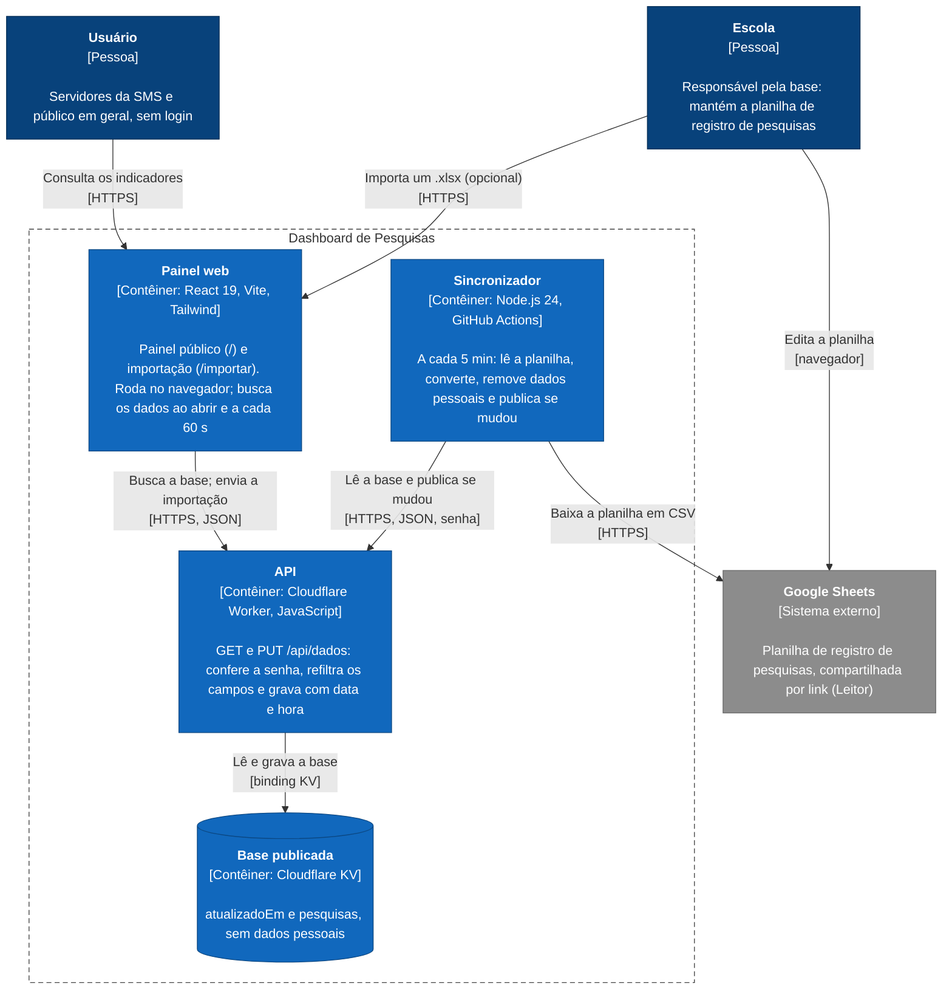
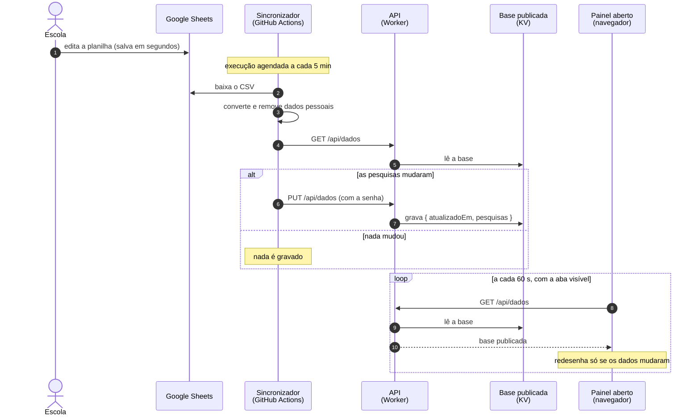

# Arquitetura e atualização dos dados

Como o Dashboard de Pesquisas da SMS é montado e como uma edição na planilha chega ao painel. Configuração e testes da sincronização: [sincronizacao.md](sincronizacao.md). Publicação: [deploy.md](deploy.md).

## Diagrama de contêineres (C4)

Legenda: azul-escuro, pessoas; azul, contêineres do sistema; cinza, sistema externo; tracejado, limite do sistema. Cada seta parte de quem inicia a comunicação e traz o protocolo entre colchetes.

| Contêiner | Código | Onde roda |
|---|---|---|
| Painel web | `frontend/src/` | no navegador; os arquivos são servidos pelo Worker (assets) e pelo GitHub Pages |
| API | `frontend/worker/index.js` | Cloudflare Workers, plano gratuito |
| Base publicada | — | Cloudflare KV (`DADOS`), um único valor JSON |
| Sincronizador | `src/` | GitHub Actions (`.github/workflows/sincronizar-planilha.yml`) |

A conversão da planilha é a mesma nos dois caminhos de entrada: `frontend/src/planilha/` padroniza os valores e descarta nomes, e-mails, títulos e anotações antes de qualquer envio. A API confere o formato de novo (`frontend/src/lib/sanitizarPesquisas.js`) antes de gravar.

## Como uma edição chega ao painel

### Quanto tempo leva

| Etapa | Quando acontece | Tempo |
|---|---|---|
| Salvar no Google Sheets | a cada edição | segundos (salvamento automático) |
| Execução do Sincronizador | agendada a cada 5 minutos (horário UTC) | o GitHub costuma atrasar alguns minutos e, em horários de pico, até cerca de 15; raramente pula uma execução |
| Duração de uma execução | — | cerca de 10 segundos |
| Gravação no KV | só quando as pesquisas mudaram | imediata no ponto da Cloudflare que gravou; até cerca de 60 s nos demais |
| Painel aberto | ao abrir, a cada 60 s com a aba visível e ao voltar para a aba | até 60 s |
| **Da edição ao painel** | — | **normalmente de 5 a 15 minutos** |
| Atualização na hora | *Actions → Sincronizar planilha do Google Sheets → Run workflow* | cerca de 30 s, mais até 60 s no painel |

### O que o painel mostra

- **"Dados atualizados em DD/MM/AAAA às HH:MM":** o momento, no horário de Brasília, em que a base foi publicada pela última vez (campo `atualizadoEm`). Execuções sem mudança não gravam nada, então esse horário só muda quando os dados mudam, e não a cada verificação.
- **Painel sem recarregar:** ao receber dados novos, o painel redesenha os indicadores e mantém os filtros escolhidos.
- **Falha temporária:** se uma consulta falhar, o painel mantém os dados que já estavam na tela.

### Importação manual

A página `/importar` continua publicando na mesma API, com a mesma senha, e tem efeito imediato. Com a sincronização ligada, a planilha do Google é a fonte: se o arquivo importado tiver dados diferentes, a próxima execução do Sincronizador substitui esses dados pelos da planilha.

## Limites que afetam a atualização

- **GitHub Actions:** 5 minutos é o menor intervalo de agendamento. Em repositório público, o GitHub desativa workflows agendados após 60 dias sem atividade no repositório; para reativar, use *Actions → Sincronizar planilha do Google Sheets → Enable workflow*.
- **Cloudflare Workers (plano gratuito):** 10 ms de CPU por execução. Converter a planilha leva mais que isso (16 a 25 ms medidos), por isso a conversão roda no GitHub Actions e não no Worker.
- **Cloudflare KV (plano gratuito):** 100 mil leituras e mil gravações por dia. Cada painel aberto faz uma leitura por minuto; o Sincronizador lê a cada 5 minutos e só grava quando há mudança. Os totais estão em [deploy.md](deploy.md#limites-do-plano-gratuito).

## Implantação

| Contêiner | Como é publicado |
|---|---|
| Painel web (GitHub Pages) | workflow `deploy-pages.yml`, a cada push na `main` que altere `frontend/` |
| Painel web e API (Worker) | `npm run deploy` em `frontend/`, ou automaticamente a cada push na `main` se o repositório estiver conectado à Cloudflare (passo 2 de [deploy.md](deploy.md)) |
| Sincronizador | o próprio workflow `sincronizar-planilha.yml`, que roda a partir da `main` |
